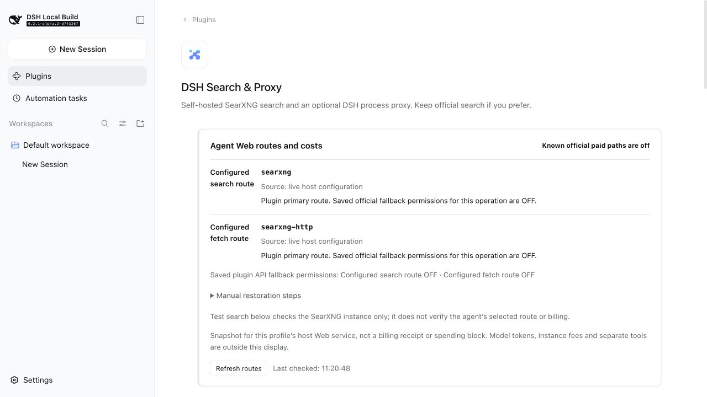

# DSH Search & Proxy

**English** | [中文](README.zh.md)

Add **web search without a search API key by default** to [DeepSeek Harness (DSH)](https://github.com/deepseek-ai/deepseek-harness), or connect DSH to a proxy you already use.

- **Want free search?** Search through SearXNG, without installing Docker or Python yourself.
- **Prefer official search?** Keep it and use the optional proxy to help with connectivity and downloads.

**Tested with:** DSH `0.2.1-rc.3`. See [compatibility and test coverage](docs/host-compatibility.md) for other versions and platforms.

## Install and start

> Upgrading from `dsh-web-search-searxng`? Follow the [migration guide](docs/rename.md) first so your saved settings keep working.

**1. Install the plugin.** Open **Plugins → Add plugin** in DSH, paste this address, then enable the plugin. No Git required.

```text
https://github.com/Chaos-Paradox/dsh-search-proxy/releases/download/v0.5.0/dsh-search-proxy-0.5.0.tgz
```

**2. Start searching.** Open **Plugins → DSH Search & Proxy** and click **Prepare and start**. Once the service shows **Ready**, choose your engines and language, save, and click **Test search**.

First use downloads the runtime; later starts reuse the cache. A prepared service starts and stops with the DSH backend. You can also connect an existing SearXNG instance. [CLI installation and more options](docs/reference.md#install-options).



## Just want the proxy?

Leave the plugin enabled and keep official search selected in DSH. **You do not need to prepare local SearXNG.** At the bottom of the plugin page, enter your existing proxy's host and HTTP / Mixed port, read the risk notice, and confirm to enable it.

The proxy is off by default. It may improve connectivity and download speed, depending on your network and proxy, and may affect other DSH network requests. [See the proxy panel](docs/proxy-0.5.0.en.jpg) · [Setup and risks](docs/proxy-risk.md).

## Costs and further reading

The SearXNG path has no per-search API fee. Model calls and official services retain their own pricing; the plugin's paid fallback is off by default.

- [Engines, languages, existing instances and authentication](docs/configuration.md)
- [Service lifecycle, downloads, cache and ports](docs/managed-runtime.md)
- [Official fallback, routing and fees](docs/official-fallback.md)
- [Detailed reference: architecture, troubleshooting and development](docs/reference.md)
- [Comparison with official search](docs/quality-benchmark.md)
- [Release notes](https://github.com/Chaos-Paradox/dsh-search-proxy/releases)

[MIT License](LICENSE)
