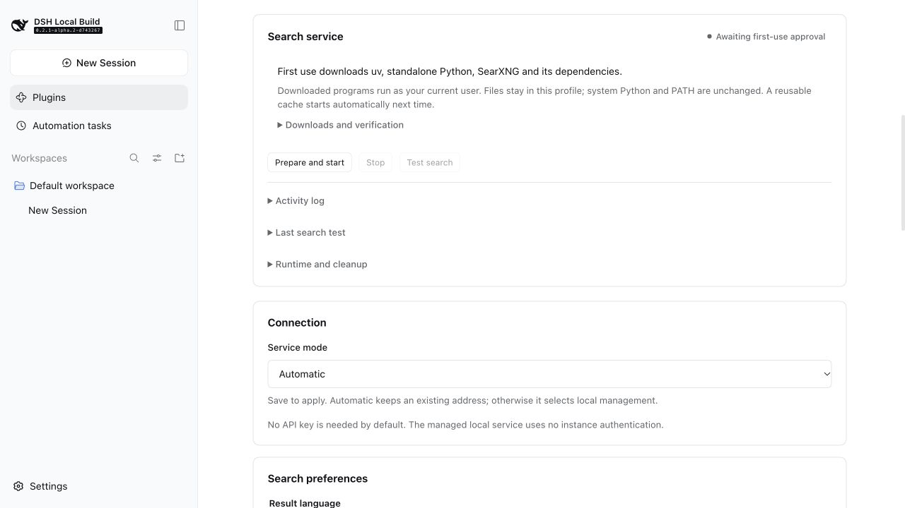
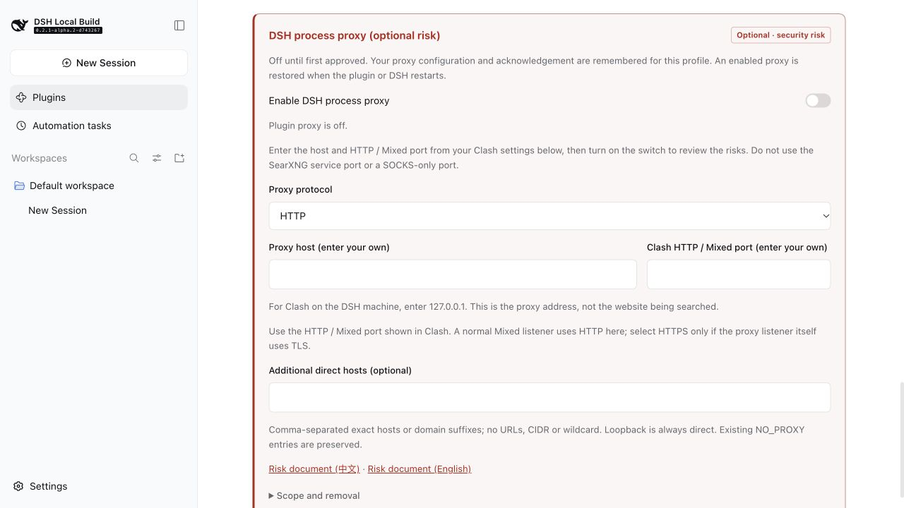
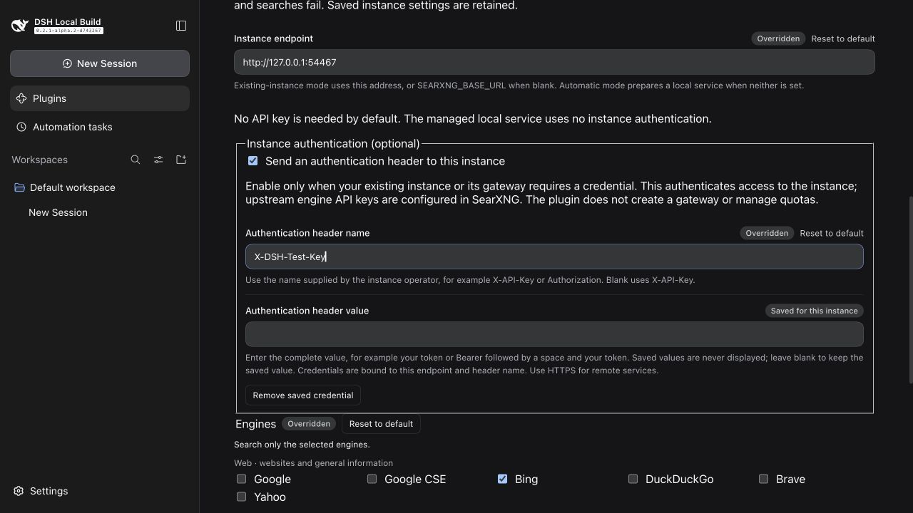

# Web Search & Optional Process Proxy for DeepSeek Harness

**English** | [中文](README.zh.md)

[](LICENSE)
[](https://nodejs.org)
[](https://github.com/searxng/searxng)
[](https://github.com/deepseek-ai/deepseek-harness)

Give [DeepSeek Harness](https://github.com/deepseek-ai/deepseek-harness) (dsh) web search through your own self-hosted [SearXNG](https://github.com/searxng/searxng) instance.

> **Keep official search and still use the optional DSH process proxy.** Proxy settings work independently of search routing and connect to your existing HTTP/HTTPS proxy. They may improve connectivity and runtime download speed, depending on your network and proxy exit. The proxy is off by default and requires explicit [risk acknowledgement](docs/proxy-risk.md). [See setup](#optional-dsh-process-proxy).

- ✅ **No API key required by default** — optional authentication for protected instances
- ✅ **No per-search API fee on the SearXNG path** — paid fallback is off by default; host route overrides have separate cost notices
- ✅ **Optional DSH process proxy** — also useful with official search; remembered and restored per profile
- ✅ **Self-hosted search relay** — your instance forwards queries to the selected search engines
- ✅ **Configure directly in DSH** — *sidebar → Plugins → SearXNG search*
- ✅ **Tested end-to-end against the official web search** — [no quality difference observed](docs/quality-benchmark.md)



*Version 0.4.1 on unpatched DSH 0.2.1-alpha.2, captured in a temporary profile on 2026-10-25. First-use downloads wait for Prepare and start; official fallback and the process proxy are off by default.*

## Quick Start

**Version 0.4.1:** adds remembered proxy configuration, default-off official Search/Fetch retries, host route/cost status and **Restore plugin routes**. First-use downloads wait for **Prepare and start**; usable caches start automatically. The card includes activity records, search reports and confirmed runtime cleanup. See [release notes](https://github.com/Chaos-Paradox/dsh-web-search-searxng/releases/tag/v0.4.1) and [managed runtime notes](docs/managed-runtime.md).

Prerequisite: DeepSeek Harness **0.2.1-alpha.2** with the standard Web/base bundles. No host patch is required. See [configuration and upgrade notes](docs/configuration.md).

**The default is a plugin-managed local SearXNG service, without user-installed Docker or Python.** After first-use confirmation it downloads a setup tool, isolated Python and search dependencies, with progress in the card. Existing endpoints or `SEARXNG_BASE_URL` continue using an external service. See [managed runtime notes](docs/managed-runtime.md).

**1. Install the plugin:**

In DSH's sidebar, open **Plugins → Add plugin**, enter `https://github.com/Chaos-Paradox/dsh-web-search-searxng#v0.4.1`, and choose **Enable now** after installation. The equivalent CLI command is:

```sh
dsh plugin --profile <name> add https://github.com/Chaos-Paradox/dsh-web-search-searxng#v0.4.1
```

**2. Set your preferences:** open **sidebar → Plugins → SearXNG search**. Review the first-use summary and click **Prepare and start** when no reusable cache exists. Wait for Ready, choose engines and result language, and save. Test search uses the saved preferences. A free port is selected automatically; advanced settings allow a specific port. To use your own existing service, select Existing instance and enter its endpoint.

Installing appends a bundle layer that selects SearXNG by default. Higher-priority user configuration still wins. Plugin-path failures report an error without official requests by default. Version 0.4.1's new Search/Fetch API retries need separate explicit opt-ins; legacy permission never enables them. Check the host route panel first: if official settings override routing, plugin fallback switches cannot block that official path's fees. Use **Restore plugin routes** to change it. Disabling/removing the bundle exposes remaining layers; user selections written by an explicit restore remain until separately changed. See [routing notes](docs/official-fallback.md).

### Default lifecycle and ports

**An already prepared local SearXNG starts with the enabled plugin and stops on normal DSH backend shutdown, plugin disablement or removal.** First preparation or a missing/incomplete cache requires approval; switching mode, changing ports or querying never grants it. The service stays running between searches. Closing a browser tab does not stop the backend. The plugin installs no OS startup service; subsequent launches reuse the profile cache. Stop retains downloads; **Clean runtime** separately confirms removal of generated runtime files, while settings and credentials remain.

**The default local port is `0`, not 8080.** The OS assigns a free loopback port and the plugin updates its effective endpoint automatically, including after a restart. You do not need to open a port manually or copy the address into settings. If you explicitly set `8080` and it is occupied, startup fails visibly rather than changing that choice. Set Local port back to `0` and save to restore automatic allocation, or choose another available fixed port.

| Service mode | Behavior |
|---|---|
| Automatic (`auto`, default) | Uses an existing saved endpoint or `SEARXNG_BASE_URL`; otherwise manages a local service. |
| Managed local service (`local`) | Forces local management, even if an external endpoint was saved before. |
| Existing instance (`external`) | Connects to your service; its startup, shutdown and port mapping remain under your control. |

If you previously used an instance at `http://localhost:8080`, automatic mode keeps using it. To switch to plugin management, select Managed local service and leave Local port at `0`; no new endpoint entry is needed. The previous external service remains independently managed. See [managed runtime notes](docs/managed-runtime.md) for cache location, recovery and shutdown limits.

## Optional DSH process proxy

**You can use the proxy while keeping official search.** Leave the plugin enabled, retain or select your official search/fetch routes in DSH's web settings, and check the host route status on the card. You do not need to prepare local SearXNG or enable the plugin's official fallback. Official routes retain their own credential and fee requirements.

1. Open **sidebar → Plugins → SearXNG search** and scroll to the red **DSH process proxy** section at the bottom.
2. Enter your existing proxy's host and **HTTP / Mixed** port; select HTTP for a normal Mixed listener. The plugin does not install a proxy server or discover ports. SOCKS and proxy endpoints with username/password authentication are unsupported.
3. Turn on the switch, open the risk statement in the dialog, then acknowledge and confirm. Cancellation leaves it off.



The proxy affects the current DSH backend process and may affect model calls, official search, page fetches, HTTP MCP and some child processes. Enabling it before first-use setup may improve GitHub, Python and PyPI dependency downloads; actual proxy use depends on the host and each tool. Existing child processes do not restart when the switch changes. Not every download or SearXNG upstream query is guaranteed to use it.

Configuration and acknowledgement are saved per profile in DSH credential storage. Restarting DSH or re-enabling the plugin restores an enabled proxy. Turning it off keeps it off and retains its configuration; Forget removes the configuration and consent. Disabling the plugin releases its current process policy. It changes neither the system proxy nor user `.env`; existing host proxies take priority. Fully restart the DSH backend and refresh after upgrading.

**Read the [full risk statement](docs/proxy-risk.md) first: the proxy takes over DNS and destination selection for some connections, so the proxy must restrict private-network and metadata targets. The proxy switch does not change search routes or automatically enable paid fallback.**

## Why use it?

This plugin gives the agent a search relay (SearXNG) on your own machine. It queries the engines selected in settings, or the instance defaults when none are selected, then returns their combined results. Available engines depend on the instance and upstream availability.

| | Hosted search APIs | **This plugin** |
|---|---|---|
| Cost | Usually billed per query | No plugin search API fee; you provide hosting and network access |
| Search API key | Usually required | **Not required by default**; protected instances can use an authentication header |
| Query path | Hosted service, then its search sources | **Your** SearXNG, then the selected upstream engines |
| Rate limit | Provider limits | Instance and upstream engine limits |
| Private-network endpoint | Depends on the service | Loopback and private-network endpoints supported |

Public web search still needs internet access from SearXNG; a cached installation does not make searching offline. DSH model-provider credentials are configured separately from this search plugin.

## Benchmark

**Does answer quality drop?** We benchmarked it end-to-end — a real dsh agent answering with real `web_search` calls, same model and prompts on both sides, blinded judging: **no quality difference observed (two 10-question runs: 6-2-2 and 3-4-3 win/loss/tie; average scores ≈4.8 vs ≈4.4)**. Methodology, per-question data, and honest limitations: [docs/quality-benchmark.md](docs/quality-benchmark.md).

## Architecture

The plugin registers the `searxng` provider into `ctx.web`. Each search starts with `GET {baseURL}/search?format=json`. The new direct Search/Fetch API retry options require independent explicit opt-ins. The default fetch route is `searxng-http`, using the target host's public HTTP provider. Legacy `allowOfficialFallback` still requires public `web.searchWithProvider`.

```
┌─────────────┐   web search   ┌──────────────┐   JSON API   ┌────────────────┐
│  dsh agent  │ ─────────────▶ │ ctx.web seam │ ───────────▶ │ your SearXNG   │
│  (LLM)      │ ◀───────────── │  (searxng    │ ◀─────────── │ instance       │
└─────────────┘  sources only  │  provider)   │   results[]  └───────┬────────┘
                               └──────────────┘                      │ aggregates
                                                          ┌──────────▼──────────┐
                                                          │ Google / Bing / DDG │
                                                          │ selected engines    │
                                                          └─────────────────────┘
```

SearXNG returns no generated answer, so results carry **sources only** — the agent reads the pages itself with `fetch` when it needs content. Each result maps to a citeable source:

| SearXNG field | dsh source field | Notes |
|---|---|---|
| `url` | `url` | entries without one are dropped |
| `title` | `title` | omitted when blank |
| `content` | `snippet` | the engine's excerpt |
| `publishedDate` | `publishedAt` | when the engine provides it |

The provider initially maps `truncated` to `false`; DSH's Web service applies `maxResults` and can set the final result's flag to `true`. No generated `content` answer is attached because SearXNG supplies sources rather than an answer.

## Security

- 🔒 **Credential-free by default** — local search needs no key. Optional instance credentials use DSH's credential store and never appear in ordinary settings or card responses.
- ⛔ **Redirects fail closed** — HTTP redirects raise `WEB_PROVIDER_ERROR`, so queries and optional credentials never follow a redirect target.
- 🏠 **Self-host friendly** — loopback (`http://localhost:8080`), private IPs, and subpath mounts (`http://host/searxng`) all work; `/search` is appended correctly.
- 💬 **Actionable errors** — 401 points to authentication; 403 can mean denied access or disabled JSON output. Neither status alone proves a key expired.

Credentials are bound to the instance endpoint (including its mount path) and header name. Managed local mode never sends saved external credentials, and official fallback receives no instance headers. Use HTTPS for remote instances.

## Configuration

### Requirements

- DeepSeek Harness **0.2.1-alpha.2** (the tested host), standard base/Web bundles, and the public `ctx.web` service. DSH peers declare `>=0.2.1-alpha.2 <0.3.0`; earlier releases are not supported. Client development dependencies are pinned to the same release train.
- Local management needs GitHub and PyPI access from the DSH backend. Dependencies are cached in the profile's `searxng/` directory for subsequent launches. Existing-instance mode needs a running service with **JSON output enabled**.
- The host's Node.js runtime must satisfy `^22.19 || >=24`; source development requires the same range.

### Optional: deploy an external SearXNG instance

Install and start [Docker](https://docs.docker.com/get-started/get-docker/) first. The following is a macOS/Linux shell example; Windows users can run it in WSL with Docker integration configured, or adapt it to native PowerShell syntax. Alternatively, follow the [official SearXNG container deployment guide](https://docs.searxng.org/admin/installation-docker.html) or connect to an existing remote instance.

```sh
mkdir -p searxng && cd searxng
cat > settings.yml <<'EOF'
use_default_settings: true
server:
  secret_key: "change-me-to-a-long-random-string"
search:
  formats:
    - html
    - json   # ← required by this plugin
EOF
docker run -d --name searxng -p 8080:8080 \
  -v "$PWD/settings.yml:/etc/searxng/settings.yml" \
  searxng/searxng
```

This section is for Existing instance mode; default local management needs none of these commands. `-d` runs the container in the background without an automatic restart policy in this example. External containers remain operator-managed; the plugin never starts or stops them. Managed local services follow the plugin/DSH lifecycle.

If host port `8080` is occupied, use `-p 8088:8080` and enter `http://localhost:8088` in the card; the right-hand side remains the container port. A directly launched source instance instead needs a `server.port` change and a service restart; see [configuration notes](docs/configuration.md#searxng-service-and-ports).

Verify JSON is enabled:

```sh
curl "http://localhost:8080/search?q=test&format=json"
```

### Operating systems and validation coverage

Local setup selects macOS, Windows and Linux glibc x64/arm64 bootstrap tools and uses public DSH subprocess APIs. The three-system workflow checks setup and lifecycle; real upstream searches and the full Web card are checked locally on macOS arm64. See [this release's validation record](docs/validation-2026-10-19-release-0.4.1.md) for exact commits, commands, CI results and uncovered cases. Historical CI runs do not certify this release. A complete CPU architecture and Linux distribution matrix is not covered.

| DSH host platform | SearXNG deployment options | Validation scope |
|---|---|---|
| macOS | Managed local service or existing local/remote instance | Local Web card and real search; CI status in release evidence |
| Windows | Managed local service or existing local/remote instance | CI setup and lifecycle; full Web card not locally verified |
| Linux | Managed local service (glibc) or existing local/remote instance | CI setup and lifecycle; full Web card not locally verified |

DSH version compatibility is separate: the minimum remains **unpatched 0.2.1-alpha.2**. An exact **0.2.1-rc.2 desktop-bundled runtime** was also exercised; that does not validate the same-named GitHub tag or all Electron behavior. See the [current release evidence](docs/validation-2026-10-19-release-0.4.1.md). The peer range `>=0.2.1-alpha.2 <0.3.0` is not a guarantee for every version.

Future updates follow the [host compatibility and release testing policy](docs/host-compatibility.md): preserve the minimum host, validate recommended/candidate versions, and record packed-artifact, real-host and settings-page evidence. The current minimum and recommended host are both `0.2.1-alpha.2`.

The endpoint must be reachable from the **DSH backend**. `localhost` means the backend's host or container; a browser on another computer does not make that computer the backend's `localhost`. A remote instance does not require every user to start SearXNG locally. For connection errors, check that the service is running and JSON is enabled, then check the card's endpoint.

### Install options

**From GitHub (tracks latest main):**

```sh
dsh plugin --profile <name> add https://github.com/Chaos-Paradox/dsh-web-search-searxng
```

**Pin the v0.4.1 release (recommended for reproducibility):**

```sh
dsh plugin --profile <name> add https://github.com/Chaos-Paradox/dsh-web-search-searxng#v0.4.1
```

This README describes plugin **0.4.1**, with credential-free managed local search by default. See [release notes and the installable tarball](https://github.com/Chaos-Paradox/dsh-web-search-searxng/releases/tag/v0.4.1), or all versions on the [Releases page](https://github.com/Chaos-Paradox/dsh-web-search-searxng/releases). Fully restart the DSH backend and refresh after upgrading. Existing external instances and usable older caches remain usable.

**From a local clone or tarball:** the same command takes an absolute path, e.g. `dsh plugin --profile <name> add /path/to/dsh-web-search-searxng`. No build step needed — `lib/` is committed.

The bundle registers SearXNG and overlays the complete `web.config` with `searchProvider: searxng` and `fetchProvider: searxng-http`. DSH replaces config objects instead of merging fields. Profile/home/CLI overrides retain higher priority; custom fetch providers in earlier layers need a later complete Web config. Installation itself writes no user-layer route. Explicitly confirming **Restore plugin routes** saves a user selection that disable/removal will retain; see [manual handling](docs/official-fallback.md). Verify the import:

```sh
dsh plugin --profile <name> list        # dsh-web-search-searxng should appear

# disable the whole bundle — expose the remaining route, keep saved settings
dsh plugin --profile <name> disable dsh-web-search-searxng

# remove — expose the remaining route, keep saved settings
dsh plugin --profile <name> remove dsh-web-search-searxng
```

### 1. Point it at your instance

**Option A — GUI (recommended):** choose a service mode, engines and result language, then save. Local mode supplies its endpoint automatically. Port changes restart the local service; engine/language changes do not. Existing-instance mode accepts your own endpoint.

The engine list groups common candidates by purpose: web, news, research, and technology/reference. It is not a live inventory of your instance; chosen names must exist and be enabled there. No selection uses the instance defaults. Other engine names and language codes remain available through the custom options, and existing custom values are preserved when editing a list selection.

**Option B — environment variable** before launching dsh:

```sh
export SEARXNG_BASE_URL="http://localhost:8080"
```

| Field | GUI label | Env fallback | Description |
|---|---|---|---|
| `mode` | Service mode | — | `auto` preserves existing endpoints, otherwise manages locally; `local` forces local; `external` uses an existing service. |
| `managedPort` | Local port | — | Default `0` selects a free port; occupied explicit ports fail visibly. |
| `baseURL` | Instance endpoint | `SEARXNG_BASE_URL` | External instance base; managed local mode uses its effective endpoint. |
| `engines` | Engines / 引擎限制 | — | Grouped multi-select list; stored as comma-separated names, e.g. `bing,duckduckgo`. Custom names are supported. |
| `language` | Language / 结果语言 | — | Dropdown for common languages plus a custom-code option, e.g. `zh-CN`, `en`, `ja`. |
| `authEnabled` | Send an authentication header | — | Default false. Only applies to an existing instance; managed local mode always omits credentials. |
| `authHeaderName` | Authentication header name | — | Default `X-API-Key`; custom authentication headers such as `Authorization` are supported. |

For a protected instance, open the card's **Instance authentication (optional)** section, enable it, and enter the header name and complete value supplied by the operator (for example `Authorization` with `Bearer <token>`). Save once, then use Test search. The value is write-only and stored through DSH credentials, not `cordis.patch.yml`. Leaving the value blank keeps the saved credential; changing the endpoint/mount or header name requires a credential for that target. Disabling authentication or resetting settings stops sending it while retaining the saved value. **Remove saved credential** deletes the value for the current target; save or discard pending edits first. Upstream engine API keys remain SearXNG `settings.yml` configuration. This plugin does not deploy authentication, billing or quota management on the server. See [configuration notes](docs/configuration.md#optional-instance-authentication).



*Actual 0.3.1 card in an isolated DSH test profile. The local fixture requires a custom header; the saved value is not displayed.*

Search reports unavailable while preparing, stopped or failed, or when external mode has no endpoint. The card exposes status, retry and logs. Test search only calls SearXNG, never official fallback.

### 2. Optional official fallback

Version 0.4.1 has two independent, default-off paid switches: one Search API attempt after a failed SearXNG search, and one Fetch API attempt after an eligible local failure. Explicitly save each permission; legacy settings do not enable the new API paths. Cancellation and local safety refusals never trigger a paid retry. Successful fallback results disclose fees, and official fetch may still fail or return a verification page.

Public host credentials and the active rc.2 Web API configuration are reused. No host patch, private registry access or temporary route switching is required. For these retries keep `searxng` / `searxng-http`; the rc.2 built-in API switch overrides both routes. The top route/cost panel offers **Restore plugin routes** with a two-route review and manual steps. Saved fallback permissions stay unchanged; higher-priority refusals include instructions. See [official API fallback](docs/official-fallback.md).

### 3. Disable, uninstall and retained settings

Disable the **entire dsh-web-search-searxng bundle**, using its installed-bundle switch or `dsh plugin --profile <name> disable dsh-web-search-searxng`; enable uses the corresponding `enable` command. With HMR, route changes apply live; without HMR, restart. Removal uses `dsh plugin --profile <name> remove dsh-web-search-searxng` (stop a running profile first for CLI removal). The remaining bundle/profile/home/CLI layers determine the restored route, including a custom earlier provider or later manual override. Re-enabling appends the bundle and may change precedence relative to other bundles.

**Disabling only the `web-search-searxng` provider row does not restore routing.** Its bundle still selects `searxng`, so searches fail visibly with `WEB_PROVIDER_CONFIGURED_MISSING`; they do not silently use paid search. Enable that row again, or disable the whole bundle.

Version 0.3.0 retires `configEffects`, the activation journal gate and the companion host patch. Installation no longer writes route ownership to the profile; removal no longer rolls back card settings or arbitrary pre-install field values. Endpoint, engines, language and fallback choices saved by the user stay in the profile for reinstallation. Read [upgrade notes](docs/configuration.md#upgrading-from-020) if an earlier patched installation left a journal or explicit SearXNG route.

## Troubleshooting

| Symptom | Cause | Fix |
|---|---|---|
| `SearXNG error (HTTP 401)` | Instance requires authentication or rejected the credential | Check the card's authentication header name/value and the instance operator's instructions |
| `SearXNG error (HTTP 403)` | Access denied, or `search.formats` lacks `json` | Check permissions/authentication; enable JSON in the instance if needed |
| `instance authentication is not ready` | No saved credential for the current endpoint/header, invalid configuration, or unavailable credential service | Save a valid credential for this target, or disable authentication for an unprotected instance |
| Search fails with provider unavailable (`WEB_PROVIDER_CONFIGURED_UNAVAILABLE`) | Local service is preparing/stopped/failed, or external mode has no endpoint | Check card status and retry; configure an address for external mode |
| Local startup reports address/port in use | An explicitly configured local port is occupied | Set Local port to `0` and save, or choose a free fixed port; the plugin does not remap an explicit choice |
| First setup fails during download or dependency installation | The DSH backend cannot reach the download/package services, or setup timed out | Read the card's diagnostic log, restore GitHub/PyPI access and retry |
| Local service reports another owner for this profile | Another DSH process is using the same profile's managed runtime | Stop the other profile process, then retry; do not run two owners for one profile |
| Search went to another provider | A later bundle or higher-priority profile/home/CLI config | Check `--dump-config` and your overrides |
| `search request failed` / ECONNREFUSED | Instance down or wrong port | For managed mode, check card status and start/retry; for external mode, check its service and endpoint (e.g. `docker ps` for a container) |
| A search result opens with a ⚠️ fallback notice | An extended host supports official fallback and SearXNG just failed once | Check the instance; disable the fallback on the card to return to strict mode |
| `WEB_PROVIDER_ERROR` mentioning a redirect | A proxy in front of SearXNG redirects | Point `baseURL` at the final address; redirects fail closed by design |
| Empty `sources` | Engines returned nothing usable (or all entries lacked URLs) | Loosen `engines`, check the instance in a browser |

## Development

```sh
pnpm install        # dependencies come from npm (@deepseek-ai/* 0.2.1-alpha.2 train)
pnpm run build      # tsdown (host + browser bundles) + tsc (browser declarations)
pnpm test           # vitest: provider behavior, redirect policy, proxy egress, card form
pnpm run typecheck  # tsc --noEmit
DSH_SOURCE_ROOT=/path/to/deepseek-harness pnpm run test:host  # after build; unpatched built host
SEARXNG_BASE_URL=http://localhost:8080 pnpm run test:e2e    # opt-in real instance
pnpm run test:managed  # first-use approval, clean setup, real search, cached remount and cleanup (network required)
```

```
src/
  index.ts      plugin entry: config schema, env fallback, provider registration
  provider.ts   SearxngSearchProvider: JSON API call, result mapping, error policy
  fallback.ts   opt-in official fallback: per-request degrade, bilingual notice, host log
  types.ts      SearXNG response types
  client/       browser bundle: the Plugins-page card (React)
tests/          vitest suites incl. redirect & egress policy
```

`lib/` is committed on purpose: installing from a git URL gives the consumer the built artifacts without a build step. **Rebuild and recommit `lib/` whenever `src/` changes.**

Known gap: the card's apply-level registration test lives upstream for now — the published `@deepseek-ai/dsh-client-test-runtime` references source files its npm package does not ship, so this repo keeps local stand-ins (`tests/helpers.ts`) for the two helpers the remaining card specs use.

## Known Limitations

- The minimum supported host remains unpatched DSH 0.2.1-alpha.2. Exact candidate host, packed-artifact and settings-page coverage is recorded separately for each build.
- The route is a bundle default, not an enforced activation condition. Later configuration may select another provider while SearXNG is still registered.
- Overlays replace the entire Web config. Include both `searchProvider` and your desired `fetchProvider` in a custom override; a partial override can remove the explicit search route and cause ambiguity.
- Bundle disable/removal restores composition, not a historical snapshot. User settings remain. Individual provider-row disable fails search until the row or bundle configuration changes.

## Contributing

Issues and pull requests are welcome. Keep authentication optional, credentials out of ordinary settings and read responses, and redirects fail-closed. Instance credentials must never reach managed local services, other endpoints, official fallback or diagnostics.

## License

[MIT](LICENSE) © [Chaos-Paradox](https://github.com/Chaos-Paradox)

## Links

- [DeepSeek Harness](https://github.com/deepseek-ai/deepseek-harness) — the host project
- [SearXNG](https://github.com/searxng/searxng) — the metasearch engine
- [SearXNG JSON format docs](https://docs.searxng.org/admin/settings/settings_search.html) — enabling `search.formats`
