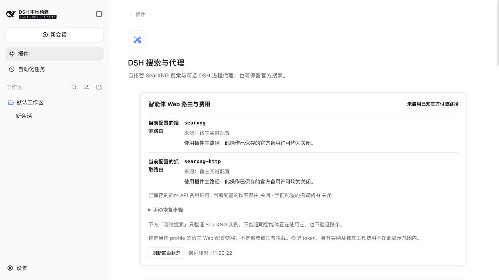

# DSH 搜索与代理

[English](README.md) | **中文**

给 [DeepSeek Harness（DSH）](https://github.com/deepseek-ai/deepseek-harness) 加上**默认不用搜索 API Key 的网页搜索**，也能接入你已有的代理。

- **想用免费搜索：** 通过 SearXNG 搜索网页，不用自己装 Docker 或 Python。
- **想继续用官方搜索：** 也可以只用代理功能，帮助 DSH 联网和下载。

**实测版本：** DSH `0.2.1-rc.3`。其他版本和平台见[兼容与验证范围](docs/host-compatibility.zh.md)。

## 安装与使用

> 从旧包 `dsh-web-search-searxng` 升级？请先看[迁移说明](docs/rename.zh.md)，避免原有配置不生效。

**1. 安装插件。** 在 DSH 打开 **插件 → 添加插件**，粘贴下面的地址，安装后启用。不需要 Git。

```text
https://github.com/Chaos-Paradox/dsh-search-proxy/releases/download/v0.5.0/dsh-search-proxy-0.5.0.tgz
```

**2. 开始搜索。** 打开 **插件 → DSH 搜索与代理**，点击「准备并启动」。等服务显示「可用」，选好引擎和语言并保存，再点「测试搜索」。

首次准备会联网下载运行环境，之后复用缓存；准备好的服务随 DSH 后端启停。已有 SearXNG 实例也可以直接连接。[命令行安装与更多用法](docs/reference.zh.md#安装选项)。



## 只想用代理？也可以

保持插件启用，在 DSH 中继续选择官方搜索，**不用准备本地 SearXNG**。在插件页面最下方，填写已有代理的主机和 HTTP / Mixed 端口，阅读风险提示后确认开启。

代理默认关闭，可能改善连接和下载速度，实际效果取决于网络与代理。它也可能影响 DSH 的其他联网请求。[查看代理界面](docs/proxy-0.5.0.zh.jpg) · [操作与风险说明](docs/proxy-risk.zh.md)。

## 费用与更多说明

SearXNG 路径不收按次搜索 API 费。模型调用和官方服务仍按各自规则收费；插件的付费备用默认关闭。

- [配置引擎、语言、已有实例和鉴权](docs/configuration.zh.md)
- [服务启停、下载、缓存和端口](docs/managed-runtime.zh.md)
- [官方备用、搜索路由与费用](docs/official-fallback.zh.md)
- [详细参考：架构、排错与开发](docs/reference.zh.md)
- [与官方搜索的对照测试](docs/quality-benchmark.zh.md)
- [版本更新记录](https://github.com/Chaos-Paradox/dsh-search-proxy/releases)

[MIT License](LICENSE)
