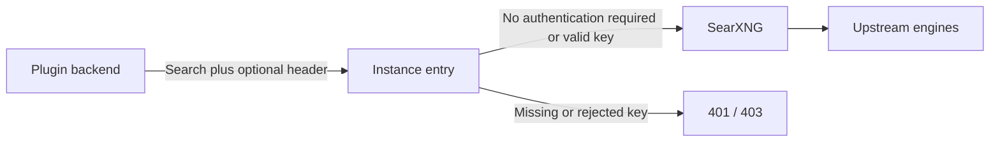

# Configuration and upgrading

English | [中文](configuration.zh.md)

## Supported composition

The minimum host remains unpatched DSH 0.2.1-alpha.2 with standard base/Web bundles. Version 0.5.0 is checked against that exact baseline; the rc.2 candidate is not revalidated for this release. See [release evidence](validation-2026-10-25-0.5.0.md). Existing users must follow the [package rename steps](rename.md), including any explicit package-name binding in saved configuration. The bundle must follow the layer declaring `id: web`. Version 0.4.1 replaces the complete Web config with `searchProvider: searxng` and `fetchProvider: searxng-http`, registers both providers, and defaults both new paid API options to false. Installation itself writes no user-layer route; explicitly confirming Restore plugin routes does. Direct `ctx.plugin()` use only registers the provider: the caller must configure `WebRuntime` routing itself.

DSH applies bundle layers in `dsh.profile.bundles` order, then profile, home, and CLI overlays. Later layers win and replace the entire config object. A profile with a custom fetch provider should contain this complete override:

```yaml
- id: web
  config:
    searchProvider: searxng
    fetchProvider: my-fetch-provider
- id: web-search-searxng
  config:
    baseURL: http://localhost:8080
    engines: bing,duckduckgo
    language: zh-CN
    allowOfficialFallback: false
```

The custom fetch provider must already be registered. An intentional `searchProvider: deepseek-official` override wins without preventing SearXNG activation. A partial `web.config` can drop the explicit search route and make multiple usable providers ambiguous. `DSH_WEB_*_PROVIDER` values only apply when the corresponding explicit field is absent. Inspect `dsh --profile <name> --dump-config` to see the effective composition; it may contain secrets, so do not share it unredacted.

## Lifecycle

0.4.1 keeps the process proxy off by default in a separate red section at the bottom of the page. Its blank host and port fields are visible immediately. For Clash on the DSH machine, enter `127.0.0.1` and your HTTP / Mixed port; a normal Mixed listener uses HTTP here. Do not use the SearXNG port or a SOCKS-only port. Open the switch to request activation, view the inline risk statement, then tick the acknowledgement and confirm to actually enable routing. The [full risk document](proxy-risk.md) remains available; reading the embedded statement does not depend on a remote page loading. Cancel, closing the modal or Escape revokes consent and keeps the proxy off, retaining the unsubmitted draft only in page memory. Configuration and the current acknowledgement are saved per profile in DSH credential storage, outside .env and ordinary profile configuration. Unloading or exit restores the prior process policy; re-enabling restores a previously enabled proxy. Turning it off is durable and retains configuration; Forget deletes configuration and consent. The same accepted statement does not prompt again; new configuration or a changed statement requires consent. Existing host proxies take priority. See the risk document for unverified connectivity, child-process and concurrent-installer limits. Search routing and paid fallback do not change, and SearXNG is not restarted. After an update, fully restart the DSH backend and refresh the browser; reinstall alone does not guarantee a cleared backend module cache.

Version 0.4.1 requires **Prepare and start** before downloading a missing/incomplete local runtime. Existing usable caches start with the enabled plugin. Disabling/removing it or normal backend shutdown stops owned work and retains caches; confirmed runtime cleanup removes generated files but retains settings/credentials. Searches reuse the running service. Closing a browser tab does not stop the backend. External mode never manages instance processes. See [managed runtime notes](managed-runtime.md) for disclosure, activity records and test reports.

Bundle enable/disable changes the ordered manifest list. Disable the whole installed bundle to restore routing; with HMR the remaining composition applies live, otherwise restart. Individual provider-row disable leaves the route selected and searches fail visibly. Removal also exposes the remaining layers, including custom earlier defaults and current user overrides. CLI removal requires the profile process to be stopped; the running Plugins page can remove bundles live with HMR.

Card writes are normal user settings. Endpoint, engines, language and fallback preference stay in the profile after bundle disable/removal and become available on reinstallation. Restoration means resolving the remaining configuration today; no pre-install snapshot or field ownership transaction is maintained. Re-enabling appends the bundle, so another bundle's relative priority may change. A higher home/CLI settings override can make a card write fail; the host preserves the previous profile values in that case.

## SearXNG service and ports

Managed local mode defaults `managedPort` to `0`: the OS assigns a free loopback port, and the plugin follows the effective endpoint automatically. No manual port opening or endpoint entry is needed. An explicitly configured port such as `8080` fails if occupied; it does not fall back to another port. Change it to `0` and save to restore automatic allocation, or select another free fixed port. Changing `managedPort` restarts the service and updates its effective endpoint.

`auto` preserves any existing `baseURL` or `SEARXNG_BASE_URL`. If you previously connected to a manual 8080 service, choose `local` in the card to switch to automatic management; keep the port at `0`. External instances require changing their own listener/container mapping and then updating `baseURL`; an endpoint change alone cannot change their port. For example, Docker `-p 8088:8080` exposes container port 8080 on host port 8088, so set the endpoint to `http://localhost:8088`. The plugin never starts or stops that external container.

Version 0.3.0 uses persistent profile caches and follows DSH startup/shutdown without installing a system startup service. The manually started `/tmp` instance from 0.2.1 validation is historical test infrastructure, not the new managed runtime.

## Optional instance authentication

Version 0.3.1 adds an **Instance authentication (optional)** section to the card. `authEnabled` defaults to false, so existing settings and the managed local service continue to work without an API key. Managed local mode omits authentication even when external-instance settings remain saved.

For an existing instance whose operator requires a request header:

1. Select Existing instance (or Automatic with an existing endpoint), enter the address, and enable authentication.
2. Enter the operator's header name, such as `X-API-Key` or `Authorization`. Blank uses `X-API-Key`. Routing/framing headers and the provider's JSON headers cannot be overridden.
3. Enter the complete value, such as a token or `Bearer <token>`, and save. Use Test search to verify it; normal searches and tests share the same credential resolution.

The password field is write-only: opening the card shows only whether a value is saved. A blank value leaves the saved value unchanged. DSH's credential service stores the value separately from normal plugin settings; this does not promise encrypted storage. The plugin binds a record to the normalized instance endpoint, including mount path, and the case-insensitive header name. Changing either selects a different record rather than sending the previous credential to a new target. Returning to a previously configured target can reuse its record. A missing credential fails before a search is sent when authentication is enabled.

Disabling authentication or resetting the settings preserves credentials while stopping their use. To delete a value, save/discard pending edits, then click **Remove saved credential** for the current target. Disabling/uninstalling the plugin also retains the stored records. Without the DSH credential service, ordinary credential-free searching still works; authentication controls cannot save a key.



The instance operator supplies the authentication gateway and issues credentials. The plugin only sends an agreed header; it does not deploy a gateway, issue keys, count usage or manage quotas. Upstream engine API keys remain separate SearXNG `settings.yml` configuration. Use HTTPS for remote endpoints; headers over plain HTTP are not encrypted. Redirects remain rejected, credentials never reach official fallback, and credential-bearing network/parse exceptions are replaced with safe diagnostics. A 401 suggests authentication refusal; a 403 may mean permission refusal or disabled JSON output, not necessarily an expired key.

## Official fallback

The 0.4.1 adds independent, default-off `allowOfficialApiFallback` (search) and `allowOfficialFetchFallback` (fetch). Legacy `allowOfficialFallback` retains its original public `searchWithProvider` requirement and never enables direct API billing. Save the new switches explicitly; search consent does not authorize fetch.

A failed SearXNG search may make one direct Search API request. The `searxng-http` fetch route uses the target host's public HTTP provider with its DNS, destination, redirect, proxy and size policy. When fetch fallback is enabled, eligible transport errors, HTTP 403/408/429/5xx and recognized verification pages permit one official Fetch API attempt. Cancellation and local safety, URL, redirect and size refusals never trigger paid fallback. An official failure is not retried again, and official fetch may also encounter anti-bot protection.

Direct API calls use public credential resolution or the initiating DeepSeek account's public authorization interface; they do not inspect private provider registries, switch global routes or create copied credentialed host providers. The rc.2 `web-deepseek-api` configuration, when active, supplies its API base and credential fields. Otherwise the documented official base and shared `DEEPSEEK_API_KEY` reference apply. Missing credentials produce an explicit error without a request. Instance authentication headers are never forwarded.

The failed query or URL is sent to the configured official API and may incur request fees. Attempts are logged without credentials, successful fallback includes a bilingual fee notice, and errors omit raw upstream text. See the [detailed route and fallback notes](official-fallback.md).

The rc.2 built-in API switch writes higher-priority `deepseek-search-api` / `deepseek-fetch-api` routes and bypasses this plugin. Turning it off selects the factory routes rather than restoring a previous SearXNG route. For this plugin's retries keep `searxng` / `searxng-http`; intentional user or custom-provider overrides still win. The card shows the configured routes.

## Upgrading from 0.2.0

Back up the profile's `package.json`, lockfile and `cordis.patch.yml` before installing 0.3.0. An unpatched installation that only failed the old activation gate can install the new package directly. No ledger is required.

If an old patched host wrote `dsh-config-effects/v1` and an explicit SearXNG route into the profile, first disable/remove the old bundle through that matching host so its journal can restore owned values. Then install 0.3.0 on current mainline. If that host is unavailable, keep a backup and manually review only the old route/settings overrides and journal before removing obsolete ownership; preserve intended user overrides and all model/credential settings. This release cannot infer a historical route or roll back a legacy journal on an unpatched host.

The removed promises are activation-enforced routing, automatic preservation of every earlier fetch field, field-level uninstall rollback, and official fallback on unpatched mainline. The replacement promises are a bundle routing default, higher-priority user configuration, restoration by layer removal, retained user settings, and explicit failure without unapproved paid search.

## Regression checks

`pnpm run build` prepares committed `lib/`. `DSH_SOURCE_ROOT=/path/to/deepseek-harness pnpm run test:host` uses that artifact with a built, unpatched 0.2.1-alpha.2 checkout. It exercises real profile loading, runtime package resolution, Include, Loader, WebRuntime, settings writes, HMR and bundle management. A local JSON endpoint and registered official probe supply deterministic HTTP sources and count official-route attempts. This is separate from live upstream-engine validation, which runs with `SEARXNG_BASE_URL=... pnpm run test:e2e`.
