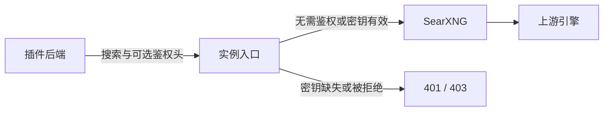

# 配置与升级

[English](configuration.md) | 中文

## 支持的组合

最低宿主仍为未打补丁的 DSH 0.2.1-alpha.2 及标准 base/Web bundle，另测试了精确提交的 rc.2 桌面随附运行时，见[发布验证记录](validation-2026-10-19-release-0.4.1.md)。插件 bundle 必须位于声明 `id: web` 的层之后。0.4.1 将完整 Web config 替换为 `searchProvider: searxng`、`fetchProvider: searxng-http`，插入提供方，并将两种新 API 备用默认关闭。安装本身不写用户层路由；主动确认「恢复插件路由」会保存用户选择。直接调用 `ctx.plugin()` 只注册提供方，调用者需自行配置 `WebRuntime` 路由。

DSH 按 `dsh.profile.bundles` 顺序应用 bundle，再应用 profile、home、CLI overlay。后续层优先，config 对象整体替换。使用自定义 fetch 提供方的 profile 应写完整覆盖，例如：

```yaml
- id: web
  config:
    searchProvider: searxng
    fetchProvider: my-fetch-provider
- id: web-search-searxng
  config:
    baseURL: http://localhost:8080
    engines: bing,duckduckgo
    language: zh-CN
    allowOfficialFallback: false
```

自定义 fetch 提供方需已注册。用户有意设置 `searchProvider: deepseek-official` 时该覆盖优先，且不会阻止 SearXNG 激活。部分 `web.config` 覆盖可能删除显式搜索路由，导致多个可用提供方存在歧义。仅当对应显式字段缺失时，`DSH_WEB_*_PROVIDER` 才生效。可通过 `dsh --profile <名称> --dump-config` 检查组合；输出可能包含密钥，不应未经脱敏分享。

## 生命周期

0.4.1 的「DSH 进程代理」默认关闭，入口在页面最底部的红色风险区。主机和端口直接可见：Clash 与 DSH 同机时，主机填 `127.0.0.1`，端口填 Clash 的 HTTP / Mixed 端口，普通 Mixed 监听选择 HTTP。不要填写 SearXNG 服务端口或 SOCKS 专用端口。填写后打开开关，会弹出风险提示；点击「查看风险声明」后，勾选框才可用，勾选并点击「确认风险并启用代理」后才真正生效。声明在界面内展开，也提供[完整风险文档](proxy-risk.zh.md)，不依赖远端链接加载才能阅读。取消、关闭弹窗或按 Escape 会撤销本次授权并保持关闭，未提交的配置仅留在当前页面内存。配置和当前版本的风险确认按 profile 保存在 DSH 凭据存储，不写 `.env` 或普通 profile 配置。停用／卸载整个 bundle 或退出时恢复原进程策略，再次启用时自动恢复先前已开启的代理；主动关闭代理则保持关闭并保留配置，「关闭并清除代理记忆」删除配置和确认。同一有效声明版本不重复提示，新配置或声明版本变更时才需确认。已有宿主代理不被覆盖。子进程环境副本、连通性未验证及第三方并发接管的限制见风险文档。本开关不改变搜索路由或付费备用，不会重启 SearXNG。更新插件后须完整重启 DSH 后端再刷新浏览器；仅卸载重装不能保证清除后端模块缓存。

0.4.1 在本地缓存缺失／不完整时，需要点击「准备并启动」后才下载；已有可用缓存随插件启用启动。禁用、卸载或正常退出后端停止自有工作并保留缓存；单独确认的清理删除生成文件，保留设置和凭据。查询复用服务，关闭浏览器标签页不停止后端。外部模式不管理已有实例。下载摘要、运行记录和测试报告详见[本地托管说明](managed-runtime.zh.md)。

启用/禁用 bundle 修改 manifest 中的有序列表。恢复路由需禁用整个已安装 bundle；有 HMR 时其余组合实时生效，否则需重启。仅禁用提供方行会留下原路由，搜索明确失败。卸载同样恢复其余配置层，包括较早自定义默认值和当前用户覆盖。CLI 卸载前需停止 profile；开启 HMR 的插件页可实时卸载。

卡片写入是普通用户设置。实例地址、引擎、语言和备用选项在禁用/卸载后保留，重新安装即可继续使用。恢复是依据当前其余配置层重新解析，不记录安装前快照或字段归属事务。重新启用会追加 bundle，可能改变其他 bundle 的相对优先级。较高优先级的 home/CLI 设置覆盖可能使卡片保存失败，此时宿主保留原 profile 值。

## SearXNG 服务与端口

本地托管的 `managedPort` 默认 `0`：操作系统分配空闲的回环端口，插件自动同步实际地址，无需手动开启端口或填写地址。若明确指定 `8080` 等端口且已被占用，启动会报错，不会自动换端口；改为 `0` 并保存即可恢复自动分配，也可选择其他空闲固定端口。修改 `managedPort` 并保存会自动重启服务并同步实际地址。

`auto` 沿用已有 `baseURL` 或 `SEARXNG_BASE_URL`。若之前连接手动启动的 8080 服务，可在卡片选择「本地自动托管」（`local`），端口保持 `0`，切换到插件自动管理。外部实例需自行修改监听或容器映射，再在卡片更新 `baseURL`；仅修改外部地址不会改变其服务端口。例如 Docker `-p 8088:8080` 将容器的 8080 暴露在本机 8088，卡片地址应填 `http://localhost:8088`。插件不会启停该外部容器。

0.3.0 使用 profile 内的持久缓存，随 DSH 启停，不注册系统开机服务。0.2.1 验证时手动启动的 `/tmp` 实例属于历史测试环境，不是新的自动托管运行环境。

## 可选实例鉴权

0.3.1 在卡片加入「实例鉴权（可选）」。`authEnabled` 默认 false，已有设置与本地自动托管继续无需 API Key。本地托管即使保留了外部实例鉴权设置，也不会发送凭据。

连接提供方要求鉴权请求头的已有实例时：

1. 选择「连接已有实例」，或在「自动选择」中沿用已有地址，填写地址并开启鉴权。
2. 填写提供方指定的名称，例如 `X-API-Key` 或 `Authorization`；留空使用 `X-API-Key`。不能覆盖路由、请求分帧或提供方的 JSON 请求头。
3. 填写完整值，例如令牌或 `Bearer <令牌>`，保存后点击测试搜索。普通搜索与测试使用同一凭据解析流程。

密码框只写不读，重新打开卡片只显示是否已保存。值留空保留已有值。DSH 凭据服务将其与普通插件设置分开保存，这不表示存储一定经过加密。插件将记录绑定到规范化的实例地址（含挂载路径）及不区分大小写的请求头名称。修改任一项会选择另一条记录，不会把原凭据发送给新目标；切回已配置目标可以复用原记录。鉴权开启但缺少凭据时，会在发送搜索请求前报错。

关闭鉴权或恢复默认停止使用凭据，但保留记录。删除值需先保存或放弃未提交编辑，再点击当前目标的「移除已保存凭据」。禁用或卸载同样保留记录。缺少 DSH 凭据服务时，普通无凭据搜索仍可用，鉴权控件无法保存密钥。



鉴权入口和凭据由实例提供方部署、发放；插件只发送约定的请求头，不建立网关、不发密钥、不统计调用或管理额度。上游引擎 API Key 仍由 SearXNG 的 `settings.yml` 管理。远端地址应使用 HTTPS，普通 HTTP 无法加密请求头。重定向继续直接失败，实例凭据不会进入官方备用；可能携带凭据的网络/解析异常会替换为安全诊断信息。401 提示检查鉴权；403 可能是权限不足或 JSON 输出未启用，并不一定代表密钥过期。

## 官方备用能力

0.4.1新增两个独立且默认关闭的选项：`allowOfficialApiFallback` 控制搜索，`allowOfficialFetchFallback` 控制抓取。旧字段 `allowOfficialFallback` 只保留原有依赖 `web.searchWithProvider` 的路径，不会自动授权新的直接 API 调用。新版开关在卡片保存后生效，清除或重置会关闭；搜索权限不授予抓取权限。

搜索主路径仍为 SearXNG，失败后才允许直接调用一次官方 Search API。抓取默认路由 `searxng-http` 复用目标宿主公开的 HTTP 抓取实现，保持其 DNS、公网目的地、重定向、代理与大小限制；开启抓取备用后，传输错误、HTTP 403/408/429/5xx 和少量可识别的验证页允许一次官方 Fetch API 尝试。取消及本地安全、URL、重定向和大小限制拒绝不会触发付费重试。官方失败不继续重试，也不保证解决反爬。

直接 API 接入不要求宿主公开 `searchWithProvider` 或 `fetchWithProvider`，不读取私有提供方注册表、不切换全局路由、不创建复制凭据的宿主官方提供方。每次失败后通过公共凭据服务解析共享 `DEEPSEEK_API_KEY`，或复用当前 DeepSeek 账号会话的公开授权接口；实例鉴权头不会进入官方请求。rc.2 存在 `web-deepseek-api` 配置时，沿用其 API 基础地址及凭据引用／字面配置。未配置时使用文档中的官方地址和共享密钥引用，缺少凭据明确报错，不发起官方请求。

备用会把失败的搜索词或 URL 发给配置的 DeepSeek API，可能按成功请求计费。发送前记录尝试，成功结果附中英双语费用提醒，失败同时报告原始原因及官方尝试状态；不回显密钥或原始 API 错误正文。详见[官方备用与路由说明](official-fallback.zh.md)。

rc.2 的内置「启用新版 Web 搜索 API」会在更高优先级的用户层选择 `deepseek-search-api` 和 `deepseek-fetch-api`，从而绕开本插件。关闭它选择的是出厂路由，不恢复先前的 SearXNG 路由。卡片显示当前搜索和抓取路由；使用本插件备用时，应保留 `searxng` / `searxng-http`。有意保留自定义抓取提供方的用户仍可覆盖它，备用不会接管该提供方。

## 从 0.2.0 升级

安装 0.3.0 前备份 profile 的 `package.json`、锁文件和 `cordis.patch.yml`。未打补丁的安装若只是被旧激活校验阻止，可直接安装新包，不需要账本。

若旧补丁宿主已向 profile 写入 `dsh-config-effects/v1` 和显式 SearXNG 路由，应先通过对应旧宿主禁用/卸载旧 bundle，使其账本恢复归属字段，再在当前主线上安装 0.3.0。若无法使用旧宿主，先保留备份，逐项检查旧路由/设置覆盖和账本，确认后再清理过时归属；保留有意设置的用户覆盖，以及模型和凭据配置。本版本无法在未打补丁宿主上推断历史路由或回滚旧账本。

已移除的承诺包括激活时强制路由、自动保留所有较早 fetch 字段、卸载逐字段回滚，以及旧版依赖逐提供方分发的官方备用。新的承诺是 bundle 默认路由、保留更高优先级用户配置、移除层后恢复路由、保留用户设置，以及未经明确允许不使用付费搜索并明确报告失败。

## 回归检查

`pnpm run build` 生成需要提交的 `lib/`。`DSH_SOURCE_ROOT=/path/to/deepseek-harness pnpm run test:host` 在已构建且未打补丁的 0.2.1-alpha.2 宿主中使用这些发布文件，验证真实 profile 加载、包解析、Include、Loader、WebRuntime、设置写入、HMR 和 bundle 管理。本地 JSON 端点和已注册官方探针提供稳定 HTTP 来源并记录官方调用次数。上游引擎真实验证单独通过 `SEARXNG_BASE_URL=... pnpm run test:e2e` 运行。
