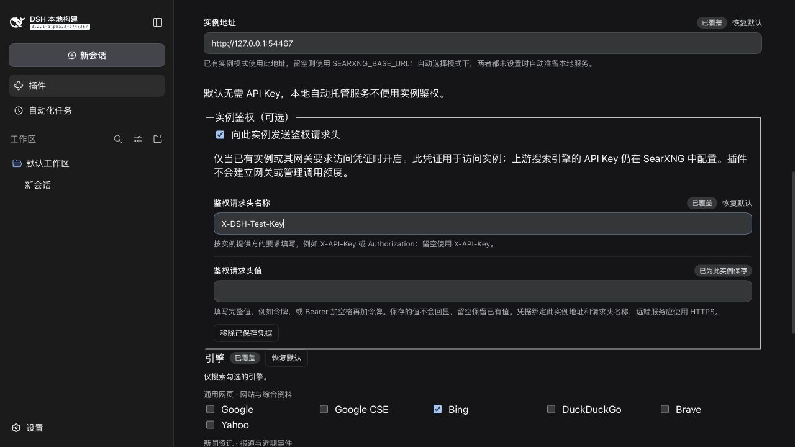

# 详细参考

[English](reference.md) | 中文

首次安装和日常使用，请先看 [README](../README.zh.md)。这里保留架构、进阶配置、排错和开发说明，供需要时查阅。

## 架构

插件以稳定 id `searxng` 注册进 dsh 的 `ctx.web` 能力缝；选择该路由后由 `GET {baseURL}/search?format=json` 提供搜索服务。新版直接 API 备用需要分别明确开启；默认本地 HTTP 抓取由 `searxng-http` 路由承接。旧 `allowOfficialFallback` 仍需要宿主公开 `web.searchWithProvider`。

```
┌─────────────┐   网页搜索     ┌──────────────┐   JSON API   ┌────────────────┐
│  dsh 智能体 │ ─────────────▶ │ ctx.web 能力缝│ ───────────▶ │ 你的 SearXNG   │
│  (LLM)      │ ◀───────────── │ （searxng    │ ◀─────────── │ 实例           │
└─────────────┘   仅来源       │   提供方）   │   results[]  └───────┬────────┘
                               └──────────────┘                      │ 聚合
                                                          ┌──────────▼──────────┐
                                                          │ Google / Bing / DDG │
                                                          │ 所选搜索引擎        │
                                                          └─────────────────────┘
```

SearXNG 不返回生成答案，因此结果只带**来源**——需要正文时智能体会自行用 `fetch` 读取页面。每项结果映射为可引用的来源：

| SearXNG 字段 | dsh 来源字段 | 说明 |
|---|---|---|
| `url` | `url` | 缺失的条目被丢弃 |
| `title` | `title` | 空白时省略 |
| `content` | `snippet` | 引擎摘录 |
| `publishedDate` | `publishedAt` | 引擎提供时才有 |

提供方初始映射的 `truncated` 为 `false`；DSH 的 Web 服务会按 `maxResults` 截断，最终结果的标记可能为 `true`。不附带生成式 `content` 答案，因为 SearXNG 提供的是来源。

## 安全

- 🔒 **默认无凭据**——本地搜索无需密钥。可选实例凭据通过 DSH 凭据存储保存，不出现在普通配置和卡片读取响应中。
- ⛔ **重定向直接失败**——HTTP 重定向抛出 `WEB_PROVIDER_ERROR`，查询文本和可选凭据不会被转发到重定向目标。
- 🏠 **自托管友好**——回环地址（`http://localhost:8080`）、内网 IP、子路径挂载（`http://host/searxng`）全部支持，`/search` 会被正确拼接。
- 💬 **可操作的错误信息**——401 提示检查鉴权，403 可能是权限不足或 JSON 输出未启用；单凭状态码不能断定密钥过期。

凭据绑定实例地址（含挂载路径）和请求头名称。本地托管不发送已保存的外部凭据，官方备用不接收实例鉴权请求头。远端实例应使用 HTTPS。

## 配置

### 前提条件

- DeepSeek Harness、标准 base/Web bundle 及公开 `ctx.web` 服务。最低支持版仍为 **0.2.1-alpha.2**，新版 `0.2.1-rc.3` 的实测反馈见[兼容说明](host-compatibility.zh.md)。DSH peer 声明为 `>=0.2.1-alpha.2 <0.3.0`，不支持更早版本；客户端开发依赖固定在同一发布版本。
- 本地托管需要从 DSH 后端访问 GitHub 与 PyPI；依赖缓存于当前 profile 的 `searxng/` 目录，后续启动复用。外部实例模式需要一个运行中且**启用 JSON 输出**的服务。
- 宿主的 Node.js 运行环境需满足 `^22.19 || >=24`；从源码开发也需要此范围的 Node.js。

### 可选：自行搭建外部 SearXNG 实例

先安装并启动 [Docker](https://docs.docker.com/get-started/get-docker/)。以下是 macOS/Linux 的 shell 示例；Windows 可在已配置 Docker 集成的 WSL 中执行，原生 PowerShell 需使用对应语法。也可以按 [SearXNG 官方容器部署说明](https://docs.searxng.org/admin/installation-docker.html)部署，或连接已有远程实例。

```sh
mkdir -p searxng && cd searxng
cat > settings.yml <<'EOF'
use_default_settings: true
server:
  secret_key: "换成一段足够长的随机字符串"
search:
  formats:
    - html
    - json   # ← 本插件必需
EOF
docker run -d --name searxng -p 8080:8080 \
  -v "$PWD/settings.yml:/etc/searxng/settings.yml" \
  searxng/searxng
```

本节用于「连接已有实例」模式，默认本地托管无需执行。`-d` 表示容器在后台运行；上述示例未配置自动重启。外部容器由部署者管理，插件不会启停它；本地托管则随插件/DSH 的生命周期自动启停。

若本机 `8080` 被占用，可将映射改为 `-p 8088:8080`，再在插件卡片填写 `http://localhost:8088`；映射右侧仍是容器端口。源码直接启动的实例则修改 `server.port` 并重启服务，详见[配置说明](configuration.zh.md#searxng-服务与端口)。

验证 JSON 已启用：

```sh
curl "http://localhost:8080/search?q=test&format=json"
```

### 操作系统与验证范围

本地托管提供 macOS、Windows 与 Linux glibc 的 x64/arm64 安装工具选择，使用公开 DSH 子进程接口。三系统 CI 检查服务准备与生命周期；真实上游搜索和完整 Web 卡片在本机 macOS arm64 验证。精确提交、命令、CI 结果和未覆盖项见[本次发布验证记录](validation-2026-10-25-0.5.0.md)，历史 CI 不作为当前构建通过的证据。未覆盖所有 CPU 架构与 Linux 发行版。

| DSH 所在平台 | SearXNG 部署选择 | 验证范围 |
|---|---|---|
| macOS | 自动托管，或已有本机/远程实例 | 本机 Web 卡片与真实搜索；CI 状态见发布记录 |
| Windows | 自动托管，或已有本机/远程实例 | CI 准备与生命周期；完整 Web 卡片未在本机验证 |
| Linux | 自动托管（glibc），或已有本机/远程实例 | CI 准备与生命周期；完整 Web 卡片未在本机验证 |

DSH 版本兼容是另一项验证：最低支持宿主为**未打补丁的 0.2.1-alpha.2**。0.5.0 针对此精确基准验证，本次未重复验证 rc.2 候选。当前发布证据见[验证记录](validation-2026-10-25-0.5.0.md)。声明的 peer 范围 `>=0.2.1-alpha.2 <0.3.0` 不等于逐版本保证。

后续更新按[宿主兼容与发布测试约定](host-compatibility.zh.md)保留最低支持版，验证推荐版与新版候选，并记录发布包、真实宿主和设置页测试证据。当前最低支持版与推荐版均为 `0.2.1-alpha.2`。

实例地址必须从 **DSH 后端**可达。`localhost` 指 DSH 后端所在的主机或容器；浏览器在另一台电脑上时，不能把浏览器所在电脑当作后端的 `localhost`。使用远程实例无需在每位用户的电脑上再启动一个 SearXNG。连接错误应先检查服务是否运行及 JSON 是否启用，再检查卡片地址。

### 安装选项

**从 GitHub 直接导入（跟踪最新 main）：**

```sh
dsh plugin --profile <名称> add https://github.com/Chaos-Paradox/dsh-search-proxy
```

**固定 v0.5.0 发布版本（推荐，可复现）：**

```sh
dsh plugin --profile <名称> add https://github.com/Chaos-Paradox/dsh-search-proxy#v0.5.0
```

**tarball 地址（不需要 Git，适合未安装 Git 的 Windows）：**

```sh
dsh plugin --profile <名称> add https://codeload.github.com/Chaos-Paradox/dsh-search-proxy/tar.gz/refs/tags/v0.5.0
```

GitHub 地址形式需要 DSH 所在机器能使用 Git；找不到 Git 时，改用压缩包地址即可。Windows 也可以执行 `winget install --id Git.Git -e` 安装 Git，再完整重启 DSH。升级时替换地址中的版本号。

本参考对应插件 **0.5.0**，默认的本地托管无需 API Key。详见[发布说明与可安装压缩包](https://github.com/Chaos-Paradox/dsh-search-proxy/releases/tag/v0.5.0)，所有已发布版本见 [Releases 页面](https://github.com/Chaos-Paradox/dsh-search-proxy/releases)。升级后完整重启 DSH 后端并刷新页面；已有外部实例和旧版可用缓存继续使用。

**本地克隆或 tarball：** 同一命令填绝对路径即可，例如 `dsh plugin --profile <名称> add /path/to/dsh-search-proxy`。无需构建——`lib/` 已提交。

Bundle 注册 SearXNG，将完整 `web.config` 覆盖为 `searchProvider: searxng`、`fetchProvider: searxng-http`。DSH 整体替换 config，不逐字段合并；更高优先级的 profile/home/CLI 配置仍然生效。较早 bundle 中的自定义 fetch 提供方需要在后续完整 Web 配置中指定。安装本身不向用户层写路由；主动确认「恢复插件路由」会写入用户选择，禁用或卸载不会替用户清除它，详见[手动处理步骤](official-fallback.zh.md)。验证导入结果：

```sh
dsh plugin --profile <名称> list        # 应能看到 dsh-search-proxy

# 禁用整个 bundle —— 恢复其余配置决定的路由，保留设置
dsh plugin --profile <名称> disable dsh-search-proxy

# 卸载 —— 恢复其余配置决定的路由，保留设置
dsh plugin --profile <名称> remove dsh-search-proxy
```

### 1. 指向你的实例

**方式 A —— GUI（推荐）：** 打开 **侧栏 → 插件 → DSH 搜索与代理**，选择服务模式、引擎与结果语言并保存。本地模式自动提供连接地址；修改本地端口会自动重启服务，修改引擎或语言无需重启。已有实例模式填写该实例的地址。

引擎列表按用途分为通用网页、新闻资讯、学术研究、技术与百科，展示常用候选，并非实例的实时清单；所选名称须在你的实例中存在且已启用。未勾选时使用实例默认配置。其他引擎名和语言代码可通过自定义选项填写，修改列表选择时会保留已有的自定义值。

**方式 B —— 环境变量**，启动 dsh 前导出：

```sh
export SEARXNG_BASE_URL="http://localhost:8080"
```

| 字段 | GUI 标签 | 环境变量回退 | 说明 |
|---|---|---|---|
| `mode` | 服务模式 | — | `auto` 沿用现有地址，没有地址时本地托管；`local` 强制本地；`external` 连接已有实例。 |
| `managedPort` | 本地端口 | — | 默认 `0` 自动选择空闲端口；指定端口占用时明确报错。 |
| `baseURL` | 实例地址 | `SEARXNG_BASE_URL` | 外部实例基础地址，自动拼接 `/search`；本地模式使用管理器实际地址。 |
| `engines` | 引擎限制 | — | 按用途分组的多选列表，仍保存为逗号分隔的名称，例如 `bing,duckduckgo`；支持自定义名称。 |
| `language` | 结果语言 | — | 常用语言下拉列表与自定义代码选项，例如 `zh-CN`、`en`、`ja`。 |
| `authEnabled` | 向此实例发送鉴权请求头 | — | 默认 false，仅用于已有实例；本地托管始终不发送凭据。 |
| `authHeaderName` | 鉴权请求头名称 | — | 默认 `X-API-Key`，可自定义为 `Authorization` 等鉴权请求头。 |

连接受保护实例时，在卡片的「实例鉴权（可选）」中开启开关，填写提供方要求的名称和完整值，例如 `Authorization` 与 `Bearer <令牌>`，保存后点击测试搜索。值只写入 DSH 凭据存储，不写入 `cordis.patch.yml`，也不回显。值留空保留已有凭据；地址、挂载路径或请求头名称改变后，需要为新目标保存对应凭据。关闭鉴权或恢复默认停止发送，但保留凭据。「移除已保存凭据」删除当前目标的值，需先保存或放弃未提交的编辑。上游引擎 API Key 仍在 SearXNG 的 `settings.yml` 中配置；插件不会为服务端建立鉴权、计费或额度管理。详见[配置说明](configuration.zh.md#可选实例鉴权)。



*隔离 DSH 测试 profile 中的真实 0.3.1 卡片。本地测试端点要求自定义请求头；保存的值不回显。*

服务准备中、已停止或失败时搜索会明确报告不可用；外部模式缺少地址也会报错。可在卡片查看状态、重试及诊断日志。测试搜索只调用 SearXNG，不调用官方备用。

### 2. 可选官方备用

0.4.1 提供两个独立、默认关闭的付费开关：搜索失败后调用一次官方 Search API，以及本地抓取发生可重试错误后调用一次官方 Fetch API。新开关需明确保存，旧版设置不自动授予新 API 调用权限；取消和本地安全策略拒绝不触发备用。每次尝试都有日志，成功结果附费用提醒，官方也可能失败或返回验证页。

沿用宿主公共凭据服务和 rc.2 的 API 配置，不要求修改宿主、不读取其私有提供方注册表。默认路由是 `searxng` / `searxng-http`；rc.2 内置的新版 API 总开关会覆盖这两条路由。顶部面板显示路由与费用，并提供「恢复插件路由」及手动步骤；恢复前确认两条变更，现有备用许可保持原样。高优先级覆盖被拒绝时显示处理方法。详见[官方备用与路由](official-fallback.zh.md)。

### 3. 禁用、卸载与保留设置

通过已安装 bundle 的开关，或 `dsh plugin --profile <名称> disable dsh-search-proxy`，禁用**整个 dsh-search-proxy bundle**；重新启用用对应的 `enable` 命令。开启 HMR 时路由实时生效，否则需重启。卸载用 `dsh plugin --profile <名称> remove dsh-search-proxy`，CLI 卸载前需停止运行中的 profile。其余 bundle/profile/home/CLI 层决定恢复的路由，包括之前的自定义提供方或后续手动覆盖。重新启用会追加 bundle，可能改变它与其他 bundle 的优先级。

**仅禁用 `web-search-searxng` 提供方行不会恢复路由。** Bundle 仍选择 `searxng`，搜索会明确报 `WEB_PROVIDER_CONFIGURED_MISSING`，不会悄悄使用付费搜索。请重新启用该行，或禁用整个 bundle。

0.3.0 移除了 `configEffects`、激活账本校验和配套宿主补丁。安装不再向 profile 写入路由归属；卸载不再回滚卡片设置或任意安装前字段值。用户保存的实例地址、引擎、语言和备用选项会保留，供重新安装使用。若旧版补丁安装留下账本或显式 SearXNG 路由，请阅读[升级说明](configuration.zh.md#从-020-升级)。

## 故障排查

| 症状 | 原因 | 解决办法 |
|---|---|---|
| 安装时报 `ERR_PNPM_GIT_RESOLVE_FAILED` / `git ls-remote failed` | DSH 所在机器的 Git 不可用，GitHub 地址形式需要它 | 安装 Git 后完整重启 DSH，或改用上方 tarball 地址 / 本地压缩包 |
| `SearXNG error (HTTP 401)` | 实例要求鉴权，或拒绝当前凭据 | 检查卡片的请求头名称和值，以及实例提供方的要求 |
| `SearXNG error (HTTP 403)` | 权限不足，或 `search.formats` 缺少 `json` | 检查鉴权和权限；必要时在实例启用 JSON |
| `instance authentication is not ready` | 当前地址/请求头没有已保存凭据、配置无效，或凭据服务不可用 | 为当前目标保存有效凭据；无需鉴权的实例可关闭开关 |
| 搜索报提供方不可用（`WEB_PROVIDER_CONFIGURED_UNAVAILABLE`） | 本地服务准备中、已停止、失败，或外部模式缺少地址 | 检查卡片状态并重试；外部模式填写地址 |
| 本地启动报地址或端口已占用 | 明确指定的本地端口被占用 | 将「本地端口」改为 `0` 并保存，或选空闲固定端口；插件不会自动改掉指定值 |
| 首次准备在下载或安装依赖时失败 | DSH 后端无法访问下载/依赖服务，或准备超时 | 查看卡片诊断日志，恢复 GitHub/PyPI 访问后重试 |
| 本地服务提示此 profile 已有其他管理者 | 另一个 DSH 进程占用同一 profile 的托管运行环境 | 停止另一个 profile 进程后重试；同一 profile 不运行两个管理者 |
| 搜索走了其他提供方 | 后续 bundle 或更高优先级的 profile/home/CLI 配置 | 检查 `--dump-config` 与覆盖配置 |
| `search request failed` / ECONNREFUSED | 实例未运行或端口不对 | 本地托管检查卡片状态并启动/重试；外部模式检查服务及地址（如容器用 `docker ps`） |
| 搜索结果开头出现 ⚠️ 降级提醒 | 扩展后的宿主支持官方备用，且 SearXNG 刚失败了一次 | 检查实例；在卡片关闭备用即恢复严格模式 |
| `WEB_PROVIDER_ERROR` 提到 redirect | SearXNG 前有代理发生重定向 | 将 `baseURL` 指向最终地址；重定向按设计直接失败 |
| `sources` 为空 | 引擎没有返回可用结果（或条目都缺 URL） | 放宽 `engines`，在浏览器里检查实例 |

## 开发

```sh
pnpm install        # 依赖全部来自 npm（@deepseek-ai/* 0.2.1-alpha.2 列车）
pnpm run build      # tsdown（宿主 + 浏览器双 bundle）+ tsc（浏览器声明）
pnpm test           # vitest：提供方行为、重定向策略、代理 egress、卡片表单
pnpm run typecheck  # tsc --noEmit
DSH_SOURCE_ROOT=/path/to/deepseek-harness pnpm run test:host  # build 后；未打补丁的已构建宿主
SEARXNG_BASE_URL=http://localhost:8080 pnpm run test:e2e    # 可选外部真实实例
pnpm run test:managed  # 首次确认、空目录准备、真实搜索、缓存重新挂载及清理（需要联网）
```

```
src/
  index.ts      插件入口：配置 schema、环境变量回退、提供方注册
  provider.ts   SearxngSearchProvider：JSON API 调用、结果映射、错误策略
  fallback.ts   可选官方备用：逐请求降级、中英双语提醒、host 日志
  types.ts      SearXNG 响应类型
  client/       浏览器 bundle：插件页卡片（React）
tests/          vitest 套件，含重定向与 egress 策略
```

`lib/` 被刻意提交：从 git 地址安装时消费者直接拿到构建产物，无需构建链。**`src/` 变更后请重建并重新提交 `lib/`。**

已知缺口：卡片的 apply 级注册测试暂留在上游——已发布的 `@deepseek-ai/dsh-client-test-runtime` 引用了其 npm 包未携带的源文件，因此本仓库为其余卡片测试所需的两个 helper 保留了本地替身（`tests/helpers.ts`）。

## 已知限制

- 最低支持宿主仍为未打补丁的 DSH 0.2.1-alpha.2；新候选的精确宿主、发布包与设置页验证以对应验证记录为准。
- 路由是 bundle 默认值，不是激活的强制条件。后续配置可选择其他提供方，同时 SearXNG 仍保持注册。
- Overlay 整体替换 Web config。自定义覆盖应同时写入 `searchProvider` 和所需的 `fetchProvider`；部分字段覆盖可能删除显式搜索路由并导致多提供方歧义。
- 禁用/卸载恢复其余配置层决定的路由，不恢复历史快照，用户设置会保留。仅禁用提供方行会导致搜索失败，直到重新启用该行或调整 bundle 配置。
